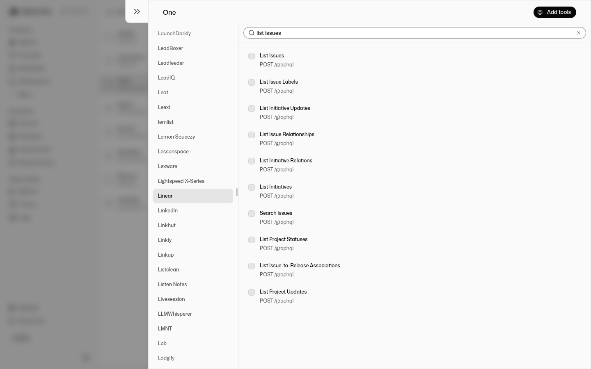

# @withone/mastra

Give [Mastra](https://mastra.ai) agents and workflows every app connected through [One](https://withone.ai): 972+ platforms, with auth handled by One.

> **Status: prototype, not yet published to npm.** Everything below runs against a live One account; see [Verifying it yourself](#verifying-it-yourself).



| Entry point | What it does |
|---|---|
| `oneTools()` from `@withone/mastra` | An agent's `tools`: one typed tool per One action, per request |
| `OneToolProvider` from `@withone/mastra/provider` | One in Mastra Studio's agent editor: browse apps, connect, attach actions without code |
| `oneStep()` from `@withone/mastra/workflows` | A One action as a workflow step, optionally paused for human approval |
| `oneTrigger()` from `@withone/mastra/triggers` | A Mastra route that starts a workflow from One webhook-relay events |
| `npx @withone/mastra init` | Wires all of the above into a new or existing Mastra project |

## Quick start

```bash
npx @withone/mastra init my-agent --platforms gmail,slack,linear
cd my-agent && npm run dev        # Studio at http://localhost:4111
```

`init` reuses your One CLI login (`one login`) or `ONE_SECRET`, creates the project with `create-mastra` if needed, writes `src/mastra/agents/one-agent.ts`, registers One in Studio, adds `ONE_SECRET` to `.env`, and installs a coding-agent skill (`.claude/skills/one-mastra`).

## Agent tools

```ts
import { Agent } from '@mastra/core/agent'
import { oneTools } from '@withone/mastra'

export const opsAgent = new Agent({
  id: 'ops',
  name: 'Ops copilot',
  instructions: 'Help the user run operations across their apps.',
  model: 'anthropic/claude-sonnet-5-5',
  defaultOptions: { maxSteps: 15 }, // discover mode needs find → get → run → answer
  tools: oneTools({
    platforms: {
      'cal-com': true,
      gmail: { allowTools: ['gmail_list_*', 'gmail_create_draft'], requireApproval: ['gmail_create_*'] },
      linear: 'discover',
    },
  }),
})
```

- **Typed tools.** Each action becomes a tool such as `cal_com_get_event_types`, with an input schema (`{ path?, query?, body? }`) from One's action catalog. Headers and connection keys are stripped, so the model never sees credentials. Mastra validates inputs before anything is sent.
- **Discover mode.** A platform with more than `maxToolsPerPlatform` (default 40) actions and no `actions`/`allowTools` filter gets `one_find_actions`, `one_get_action` and `one_run_action` instead. These are restricted to the platforms you enabled.
- **Connect links.** A platform with no usable connection becomes `connect_<platform>`, which returns `{ connectRequired, url }` for the agent to hand to the user. With a secret key the link opens One's dashboard.
- **Controls.** `allowTools` / `disallowTools` / `requireApproval` take tool-id globs, and `requireApproval` maps to Mastra's tool approval. Results over `maxResultChars` (default 30 000) are truncated before they reach the model.
- **Per request.** The resolver runs on every request, so new connections appear without a redeploy. Catalogs and schemas are cached for 10 minutes and connections for 30 seconds.

### Per-user access with One Connect

```ts
import { createOneConnect } from '@withone/connect/server'

const oneConnect = createOneConnect({ clientId, clientSecret, redirectUri, connectKey, userStore })

oneTools({
  connect: oneConnect,
  userId: ({ requestContext }) => requestContext.get('userId'),
  connectUrl: ({ platform }) => `/api/one/authorize#one_connector=${platform}`,
  platforms: { gmail: true, slack: true },
})
// agent.generate(msg, { requestContext: new RequestContext([['userId', user.id]]) })
```

How it behaves:

- Each request acts with that user's grant.
- A user who hasn't connected an app gets `connect_<platform>` pointing at your authorize route.
- If access is revoked mid-session, the tool returns a reconnect link.
- A call outside the grant comes back as `blockedByGrant: true`.

## Mastra Studio

```ts
import { Mastra } from '@mastra/core'
import { MastraEditor } from '@mastra/editor'
import { OneToolProvider } from '@withone/mastra/provider'

export const mastra = new Mastra({
  storage,
  editor: new MastraEditor({ toolProviders: { one: new OneToolProvider({ requireApproval: ['*_delete_*'] }) } }),
})
```

`OneToolProvider` implements Mastra's `ToolProvider` contract (`@mastra/core/tool-provider`): toolkits are One platforms, tools are One actions, and connections are One connection keys. In Studio go to **Agents → Create agent → Tools → One**: browse apps, search actions, pick tools, and pin a connection.

The Connect flow works like this:

1. It opens One's dashboard on the app's connect dialog.
2. It polls until the new connection is operational.
3. It tags the connection with the flow id so the pin survives restarts.

## Workflow steps

```ts
import { createWorkflow } from '@mastra/core/workflows'
import { oneStep } from '@withone/mastra/workflows'

const refund = await oneStep({ platform: 'stripe', action: 'stripe_create_a_refund', requireApproval: true })
const notify = await oneStep({ platform: 'slack', action: 'Send Message' })

export const refundFlow = createWorkflow({ id: 'refund', inputSchema, outputSchema })
  .then(refund)
  .map(async ({ getStepResult }) => ({ body: { channel: '#finance', text: `Refunded ${getStepResult(refund).data.id}` } }))
  .then(notify)
  .commit()
```

- `action` takes a tool id, a One action id or the exact title.
- `requireApproval` suspends the run. Resume it with `run.resume({ step: refund, resumeData: { approved: true } })`.
- A declined approval ends the workflow, unless you set `onDecline: 'continue'`.
- A non-2xx response fails the step, unless you set `failOnError: false`.

## Triggers

```ts
import { oneTrigger } from '@withone/mastra/triggers'

new Mastra({
  workflows: { refundFlow },
  server: { apiRoutes: [oneTrigger({ path: '/one/stripe', workflow: 'refundFlow', eventTypes: ['charge.failed'] })] },
})
```

- **Signature check.** The route verifies `X-Relay-Signature` (HMAC-SHA256 of the raw body with `ONE_RELAY_SECRET`).
- **Responses.** Bad signatures get 401. Repeated `relayEventId`s are acknowledged as duplicates, and unlisted event types are acknowledged and ignored. Otherwise the route starts the workflow and answers 202.
- **Connecting a relay.** Point a One relay `url` action at the route:
  ```bash
  one relay create --connection-key <stripe-key> --create-webhook --event-filters '["charge.failed"]'
  one relay activate <id> --actions '[{"type":"url","url":"https://<host>/one/stripe","secret":"<ONE_RELAY_SECRET>"}]'
  ```

## Configuration

| Variable | Used by |
|---|---|
| `ONE_SECRET` | everything (secret-key mode) |
| `ONE_BASE_URL` | a non-production One API, e.g. `https://development-api.withone.ai` |
| `ONE_APP_URL` | One dashboard origin for connect links (default: `https://development.withone.ai` for the dev API, else `https://app.withone.ai`) |
| `ONE_RELAY_SECRET` | `oneTrigger` |

Peer dependencies:

- `@mastra/core >=1.76 <2` and `zod ^3.25 || ^4`
- optional: `@mastra/editor` (Studio provider) and `@withone/connect` (per-user mode)

Node ≥ 22.13.

## Development

```bash
pnpm install
pnpm test            # 53 offline tests against fake One / Connect APIs, plus real Mastra workflows
pnpm typecheck
pnpm build

# Live, read-only checks against a real One account (reads .env, or exported vars):
cp .env.example .env   # then set ONE_SECRET (and ONE_BASE_URL for dev)
pnpm smoke                                   # oneTools
pnpm smoke:provider   # OneToolProvider
pnpm smoke:workflow   # oneStep with approve / decline
```

`examples/studio` is a Mastra app that uses every entry point. Run it with `pnpm install --ignore-workspace && npx mastra dev`.

## Verifying it yourself

See [docs/VERIFY.md](docs/VERIFY.md) for a start-to-end walkthrough.

## Licence

Apache-2.0
